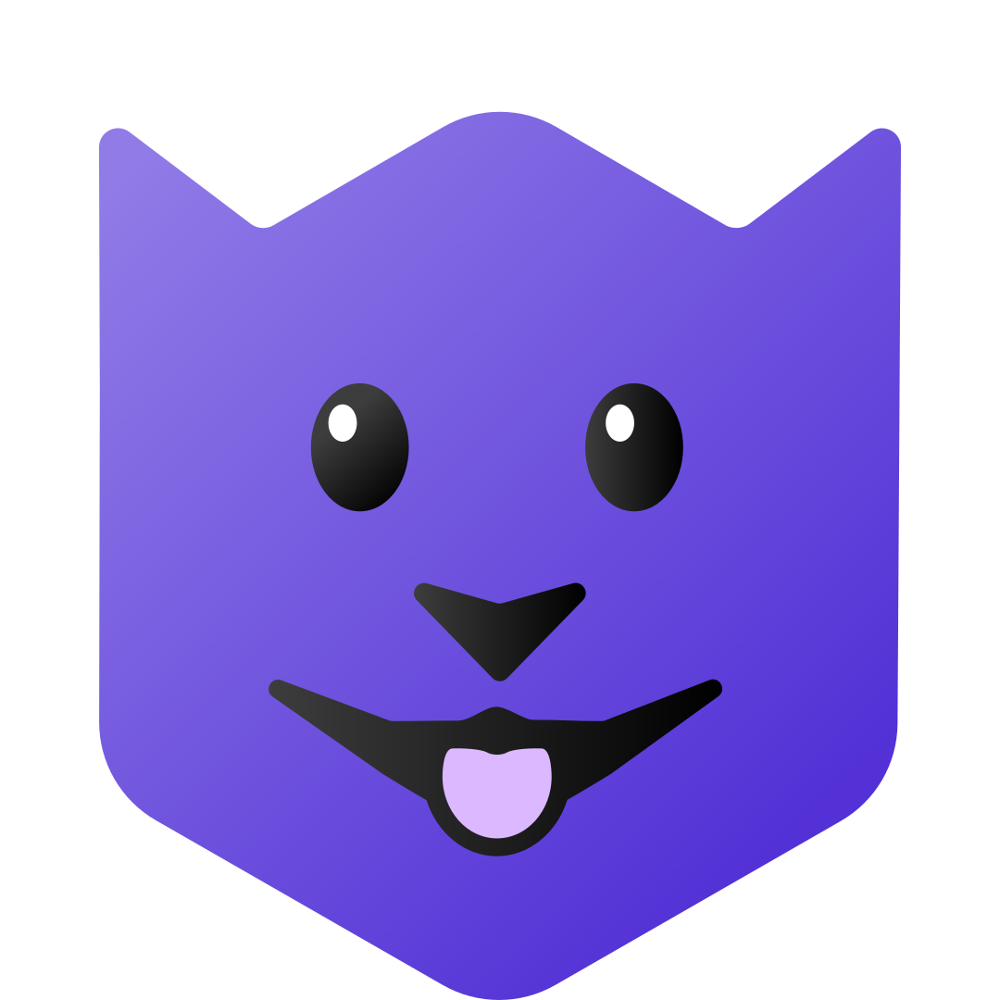

# Cubusky Website

[](https://app.netlify.com/sites/cubusky/deploys)

The official [Cubusky Website](https://cubusky.com).

---

<p align="center">

</p>

This is a Next.js application generated with
[Create Fumadocs](https://github.com/fuma-nama/fumadocs).

Run development server:

```bash
npm install # first-time only
npm run dev
```

Open <http://localhost:3000> with your browser to see the result.

### Frontmatter schema changes

After changing a frontmatter schema in `lib/schemas.ts`, restart the development server. Fumadocs watches `source.config.ts`, but not the schema files it imports. If fields are still missing, stop the server, remove `.next/dev/cache/turbopack`, and run `npm run dev` again to recompile cached MDX content.

## Contributing

If you're adding more than just documentation, it would help to be familiar with Next.js and Fumadocs:

- [Next.js Documentation](https://nextjs.org/docs) - learn about Next.js
  features and API.
- [Learn Next.js](https://nextjs.org/learn) - an interactive Next.js tutorial.
- [Fumadocs](https://fumadocs.vercel.app) - learn about Fumadocs
